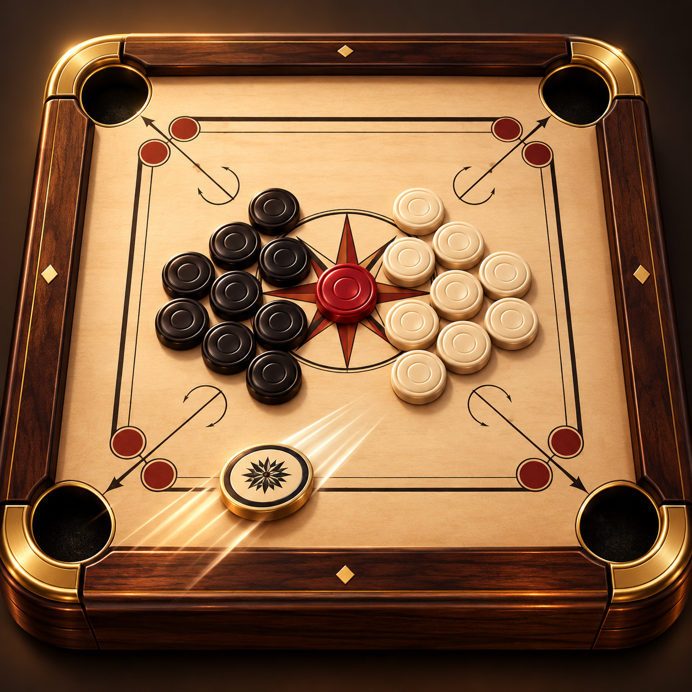

# Carrom Duo

**A native carrom game for two people sharing one iPhone or iPad, with a computer opponent for solo play.**

Carrom Duo is an early, playable iOS prototype built with SwiftUI and SpriteKit. It focuses on the board, shot feel, scoring, queen cover, and pass-and-play. Local demo play is available without an account.

> **Project status:** prototype; not yet submitted to the App Store. Email accounts, online multiplayer, cloud saves, and Apple Arcade distribution are not implemented.



## What works today

- Pass-and-play on one device and a computer opponent.
- Pull back from the striker to set shot strength; reposition the striker along the baseline before a shot.
- A fixed-step, 120 Hz board simulation using meters, kilograms, and seconds for motion, friction, and collision calculations; SpriteKit positions are converted at the rendering boundary.
- Swept-circle time-of-impact checks prevent fast discs from crossing through one another between physics steps; leftover step time is carried into the next frame when the collision-event budget is reached.
- The computer opponent budgets residual impact energy for fallback contact shots instead of stopping at the target with no planned coin travel.
- Pocket detection, immediate score snapshots, turn changes, striker fouls, and queen cover handling.
- Original home and match music, collision sounds, score/foul/queen cues, and victory/defeat audio.
- A match result overlay with final scores, Play Again, and Back to Home Screen.
- Independent, saved music and sound-effects switches, available from the speaker button.
- A local demo-player route that skips sign-in.
- An optional Sign in with Apple entry point. The app currently uses the returned first name for the in-memory session only; it has no account service or cloud profile.

This prototype uses a simplified point-scoring ruleset. It is not an official tournament rules implementation. The email screen explains that email sign-in is not connected, and the Apple Arcade information screen clarifies that this build is not an Apple Arcade title.

## Technology and structure

- **SwiftUI** presents the welcome, loading, and match screens.
- **SpriteKit** draws the board, pieces, striker, and aim guide.
- **CarromScene** owns shot input, the fixed-step motion solver, the computer shot planner, pockets, scoring, and turns.
- **MatchSnapshot** carries score, active player, status, and the winner from the scene to SwiftUI.
- **GameAudioManager** plays one looping music track and a bounded pool of effects using AVFoundation.
- **GameOverlayViews** presents accessible audio settings and the match result dialog.
- **AuthenticationServices** provides the optional Apple sign-in entry point.
- **XCTest** covers physics math, pocket scoring, fouls, rail rebounds, and computer shot planning.
- No third-party package dependencies are configured.

```text
CarromDuo/
  CarromDuoApp.swift                 SwiftUI app entry point
  ContentView.swift                  Welcome, sign-in explanation, loading, and match UI
  CarromScene.swift                  SpriteKit board, motion, AI, and match rules
  GameMode.swift                     Game mode and match snapshot models
  GameAudioManager.swift             Music transitions, effects, and audio lifecycle
  GameOverlayViews.swift             Audio controls and win/loss overlay
  Audio/                            Original WAV music and effects; CC0 license notes
  Assets.xcassets/                   Home artwork and app icon
  CarromDuo.entitlements             Sign in with Apple entitlement
Tests/
  CarromDuoPhysicsTests.swift        Physics and rule regression tests
  CarromDuoAudioTests.swift          Asset decoding, event dispatch, mute, and audio lifecycle
  CarromDuoUITests.swift             Win/loss, replay/home, settings, and responsive result UI
Tools/
  generate_audio.py                 Reproducible original audio synthesis (Python standard library)
Design/
  CarromBoardDuo-AppIcon-Concept.png Source concept artwork
Docs/
  App-Store-Launch.md                Listing draft, screenshot plan, and release audit
```

## Build and run

Requirements: macOS with Xcode 27.1 or later and an iOS 17+ simulator. The project targets iOS 17 and supports iPhone and iPad. There are no external packages to install.

1. Open `CarromDuo.xcodeproj` in Xcode.
2. Select the `CarromDuo` scheme and an iOS simulator.
3. Choose **Run**. On the welcome screen, tap **Play as Demo Player** to open the game without signing in.

For a command-line simulator build:

```sh
xcodebuild -project CarromDuo.xcodeproj \
  -scheme CarromDuo \
  -destination 'platform=iOS Simulator,name=iPhone 17' \
  build
```

Run the test suite with:

```sh
xcodebuild test -project CarromDuo.xcodeproj \
  -scheme CarromDuo \
  -destination 'platform=iOS Simulator,name=iPhone 17' \
  -parallel-testing-enabled NO
```

## Physics notes

Pull distance maps to a bounded launch speed in meters per second. Board lengths, friction, restitution, and disc impulses are calculated in meters, kilograms, and seconds; only SpriteKit node positions use points. A deterministic 1/120-second loop applies Coulomb-style sliding friction and swept-circle time-of-impact collision resolution. The computer planner converts route lengths to meters when estimating the launch speed needed for a shot.

The board scale, masses, friction, restitution, and launch-speed limits are tuning assumptions, not laboratory measurements from a physical carrom board. Translation is simulated; spin and tangential collision friction are not yet modeled. See the launch audit for remaining validation work.

## Audio and match results

Home music continues through sign-in and loading, fades out when a match starts,
and is replaced by a separate match loop. Only one music player exists. Match
completion fades the loop out, stops old effects, and plays one result cue. Replay
clears match state and pending computer actions; Home pauses and resets the board
and restores the home theme. Audio pauses while the app is inactive, follows the
device's Silent Mode, and tolerates interruptions or missing assets. The speaker
button independently controls music and effects; these preferences use UserDefaults.

Carrom has four shared pockets, not player-owned goals. Pocketing your color is
rewarding; pocketing the other color credits that player and uses a warning cue.
The striker pocket has its own negative cue. When the computer pockets the striker
or gifts the human a coin, a comic descending disaster cue marks the computer's
mistake. No new scoring events or goal rules are introduced for audio. Collision
sounds require an approaching impact and are rate-limited; pocket effects use the
same deduplicated events as scoring. Queen cover uses a separate ascending cue.

All audio is original, generated without third-party samples. No audio files,
licenses, API keys, or extra setup are needed. See `CarromDuo/Audio/README.md` for
individual assets and the CC0 dedication; run `python3 Tools/generate_audio.py`
to recreate them. Assets are bundled through the project's Audio folder reference.

Against the computer, results read YOU WON! / YOU LOST! from the human's
perspective. Pass-and-play identifies WHITE WINS! / BLACK WINS! because both
players share the screen. The modal blocks board input and VoiceOver access to
the underlying controls, supports Reduce Motion, and scrolls on small displays.

The shared scheme includes physics, audio lifecycle, and UI tests. UI tests use
DEBUG-only launch environment fixtures to resolve the ninth coin through the
existing match-resolution code, then exercise replay, home, controls, and both
result layouts. They do not create a second win/scoring implementation.

Both colors are checked for board completion: accidentally pocketing the other
player's last coin can finish the board for that player once the queen is settled.
Until then, the final coin is returned so a queen-cover opportunity remains and
the computer cannot be left with an empty set of playable coins.

## Privacy and account behavior

The game can be played as a demo without an account. There is no Carrom Duo backend, email account service, analytics SDK, advertising SDK, or network game service in this repository. Game scores and identity are currently held in app memory and are not synced. The Apple sign-in flow uses Apple's platform authentication and reads the returned first name for the current session; no server-side account is created.

These code observations are not a substitute for the privacy policy and App Privacy answers required before distribution. No public support or privacy-policy URL is configured yet. Do not submit until those are published and accurately reflect the release build.

## Roadmap

### Essential before release

- Finish and validate a consistent ruleset, including end-game behavior and edge-case turn transitions.
- Exercise input, accessibility, Dynamic Type, appearance, and layout on supported iPhones and iPads.
- Decide whether Apple sign-in remains useful without accounts; otherwise remove it. Implement email authentication only if a real service and account-deletion flow are planned.
- Publish support and privacy pages, then complete App Store privacy disclosures from verified data practices.
- Capture and review real screenshots from the release build; validate signing, archive, and TestFlight.

### High impact

- Calibrate shot strength, friction, and rebounds against measured physical-board shots.
- Improve VoiceOver operation and larger text support around the board and score controls.
- Refine onboarding, settings, and match feedback using player testing.

### Strategic

- Consider online play, cloud profiles, saved matches, or tournaments only after validating demand and defining their privacy and service requirements.

## Engineering decisions

SpriteKit handles scene rendering while the game owns motion advancement in a fixed-step solver. That gives the shot model a predictable time step and keeps the math testable without adding a third-party physics package. SwiftUI observes compact match snapshots instead of owning per-frame piece positions.

## Contributing and license

The repository currently has no `CONTRIBUTING.md` or `LICENSE`. Until a license is added, no open-source reuse permission is granted. For proposed changes, open an issue or pull request with a short explanation and relevant simulator steps.

## Links

- [App Store launch draft and readiness audit](Docs/App-Store-Launch.md)
- [GitHub repository](https://github.com/Skeeb32/Carrom-Board-Game)
